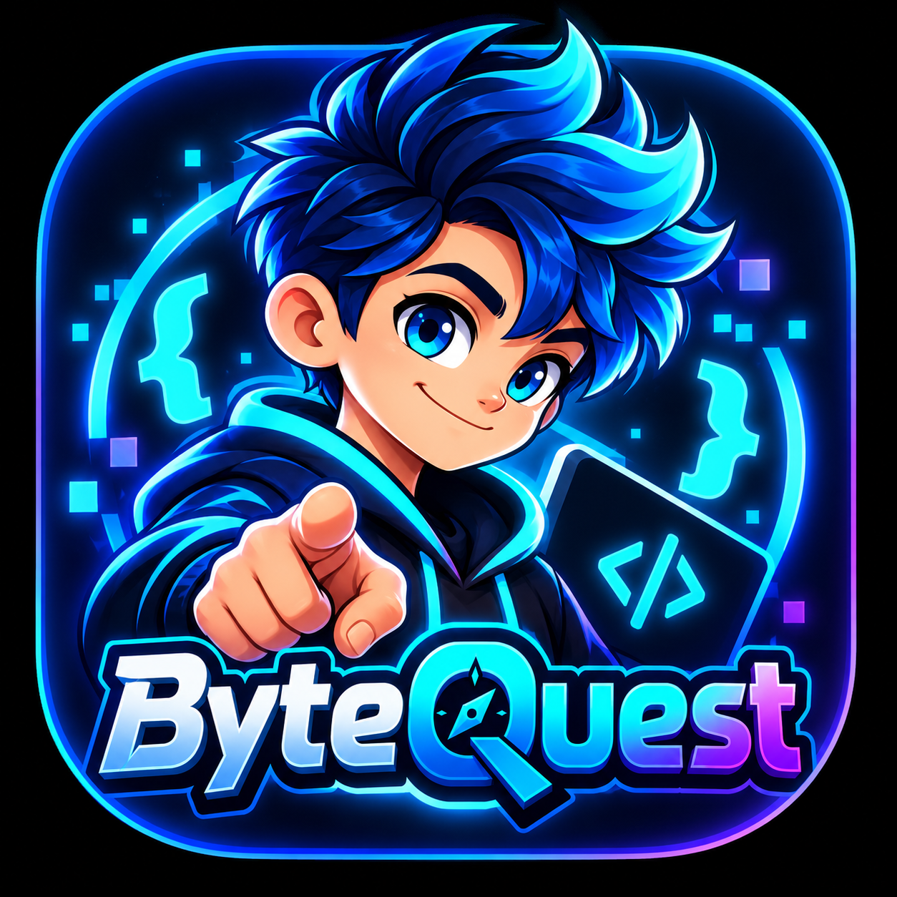

# 🎮 ByteQuest

<p align="center">
  
</p>

<p align="center">
  <b>A gamified, interactive coding quiz adventure built with Flutter.</b><br>
  Test your knowledge across programming languages, master code snippets, and level up with your companion mascot <b>Codie</b>!
</p>

<p align="center">
  <a href="https://flutter.dev"></a>
  <a href="https://dart.dev"></a>
  <a href="LICENSE"></a>
  <a href="https://github.com/anuraggggggg/byteQuest/actions"></a>
</p>

---

## 🌟 Key Features

- 🧠 **Multi-Language Quizzes**: Deep dive into Dart, Flutter, Python, and JavaScript challenges.
- 👾 **Codie & Mascot Companion**: An animated, responsive in-game companion that reacts to your correct and incorrect answers with expressive states.
- 💻 **Syntax-Highlighted Code Snippets**: Clean, dark-mode terminal cards designed for reading complex code blocks on mobile screens.
- 🏆 **Stage & Level Progression**: Unlock higher tiers as you advance from Beginner Dev to Senior Architect.
- ⚡ **Instant Feedback & Hints**: Detailed pedagogical explanations and hints for every question.
- 🎨 **Cyberpunk & Glassmorphism Aesthetic**: Modern dark theme with neon accents, custom gradients, and micro-interactions.

---

## 📂 Project Structure

```
lib/
├── core/
│   └── theme/
│       ├── app_colors.dart        # Neon & dark palette tokens
│       └── app_theme.dart         # Material 3 dark theme configuration
├── features/
│   ├── auth/                      # Authentication & profile screens
│   ├── codie/                     # Codie interactive companion logic
│   ├── mascot/                    # Byte mascot animations & sprites
│   └── quiz/                      # Core quiz engine
│       ├── data/                  # Question stages & datasets
│       ├── domain/                # Question & Quiz domain models
│       └── presentation/          # Stage select, quiz arena, result screens
│           └── widgets/           # Code snippet card, options, header
└── main.dart                      # Application entry point
```

---

## 🚀 Getting Started

### Prerequisites

- [Flutter SDK](https://docs.flutter.dev/get-started/install) (`>= 3.0.0`)
- [Dart SDK](https://dart.dev/get-dart) (`>= 3.0.0`)
- Android Studio / Xcode / VS Code with Flutter extensions

### Installation

1. **Clone the repository:**
   ```bash
   git clone https://github.com/anuraggggggg/byteQuest.git
   cd byteQuest
   ```

2. **Install dependencies:**
   ```bash
   flutter pub get
   ```

3. **Run the application:**
   ```bash
   # Run on connected device or emulator
   flutter run
   ```

4. **Run tests:**
   ```bash
   flutter test
   ```

---

## 🛠️ Tech Stack

| Category | Technology |
|---|---|
| **Framework** | [Flutter](https://flutter.dev) (iOS, Android, Web, Desktop) |
| **Language** | [Dart](https://dart.dev) |
| **Design System** | Custom Glassmorphism Dark Theme (Material 3) |
| **Architecture** | Feature-First Clean Architecture |
| **State Management** | ValueNotifier & Controller pattern |

---

## 🤝 Contributing

Contributions, issues, and feature requests are welcome! Check out the [Contributing Guide](CONTRIBUTING.md).

---

## 📄 License

This project is licensed under the MIT License - see the [LICENSE](LICENSE) file for details.
